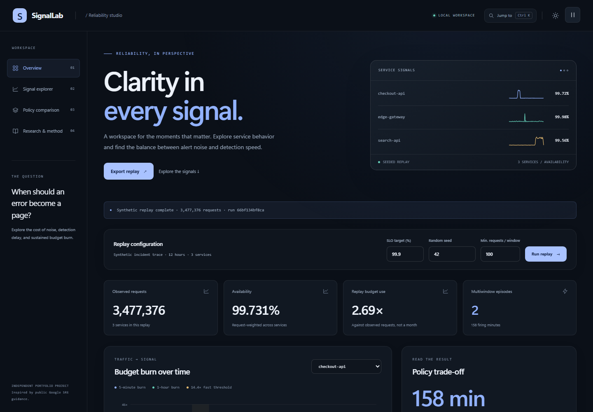

# SignalLab

[](https://github.com/chauhanavi21/signallab/actions/workflows/verify.yml)

An independent **request-weighted SLO alert replay studio**, inspired by public engineering guidance. Working Python backend, analytics, failure cases, reproducible evidence and an accessible animated interface.

**[Open interactive demo](https://chauhanavi21.github.io/signallab/) | [Watch the walkthrough](https://chauhanavi21.github.io/signallab/watch.html)**



[Download the verified source ZIP](https://github.com/chauhanavi21/signallab/releases/latest/download/signallab-source.zip).

Run locally with Python 3.11+: `python signallab/server.py`. No runtime install or build step. The [application README](signallab/README.md) covers controls and measured findings. See the [recruiter guide](RECRUITER_GUIDE.md) for a quick technical review and the [research/design](signallab/docs/RESEARCH_AND_DESIGN.md) for source-to-code decisions.

The live demo runs the existing Python logic in your browser. Each tab is isolated and data resets on reload. Its first load downloads the Python runtime; it does not host the Python HTTP server. [Execution modes and validation limits](signallab/docs/RELEASE.md) explain the boundary, accessibility audit, mobile lab results, historical data and recording.

```powershell
python signallab/verify.py
python tools/package.py
python tools/package.py --check
```

GitHub Actions runs core/HTTP tests on Windows and Ubuntu, browser workflows in Chromium/Firefox/WebKit, accessibility and mobile lab checks, historical-data validation, and the Pages build. Deployment waits for validation and source packaging. [View actual CI runs](https://github.com/chauhanavi21/signallab/actions).

This is a portfolio prototype, with no company endorsement, affiliation, or implied hiring outcome.
