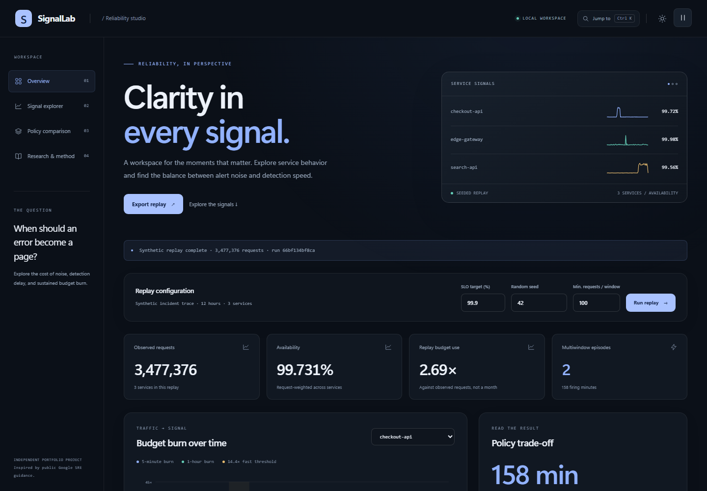

# SignalLab

A local SLO alert replay studio: compare the noise, firing duration, and detection delay of three alert policies on the same traffic. Inspired by public Google SRE engineering guidance.



## Public demo and release checks

[Interactive demo](https://chauhanavi21.github.io/signallab/) | [Captioned walkthrough](https://chauhanavi21.github.io/signallab/watch.html) | [CI](https://github.com/chauhanavi21/signallab/actions). The browser demo uses the same Python domain logic with temporary per-tab state. See [release evidence](docs/RELEASE.md) for its limits, three-engine checks, accessibility/mobile measurements, and historical-data replay.

## Run

Python 3.11 or newer. No runtime packages, credentials, cloud resources, or build step.

```powershell
cd signallab
python server.py
```

Open http://127.0.0.1:8770. Stop a foreground server with Ctrl+C. Use `--port 8780` if needed. Runtime requests stay on loopback; research links open their public websites only when clicked.

The commands above start from the repository root containing `signallab/`. If you are already in that application folder, run `python server.py` directly. The [recruiter guide](../RECRUITER_GUIDE.md) covers the repository workflow and source ZIP.

## Try the project

1. Run the default synthetic replay: 12 hours, three services, two actionable incident labels, and a brief disturbance excluded from those labels.
2. Switch between checkout and search in the burn chart. Compare five-minute and one-hour burn.
3. Compare all three policies. A shorter firing duration can come with a longer detection delay.
4. Change the SLO or minimum traffic gate, then run the same seed again.
5. Download the sample CSV, import another trace, and export the computed JSON report. Imported traces have no fabricated incident scores.

## Actual default result

SLO 99.9%, seed 42, at least 100 requests per evaluated window; 3,477,376 observed requests.

| Policy | Episodes | False episodes | Firing minutes | Median detection delay |
|---|---:|---:|---:|---:|
| One-minute SLO threshold | 88 | 86 | 303 | 0 min |
| Five-minute burn only | 2 | 0 | 207 | 3 min |
| Multiwindow burn | 2 | 0 | 158 | 37 min |

All three detected both labeled incidents in this trace. The multiwindow policy saves 49 firing minutes relative to the five-minute policy and detects later. It is not a universal winner. See the [three-seed findings](docs/FINDINGS.md).

## Interface and motion

The redesigned workspace includes light/dark themes, animated data views, scroll-triggered reveals, sticky section navigation, keyboard section search (Ctrl+K / Cmd+K), and a persistent motion control. System reduced-motion preferences are respected. See the [interface notes](docs/INTERFACE.md) for controls, implementation, and verification scope.

## Verify

```powershell
python verify.py
```

This runs **21 core/HTTP tests** and regenerates [policy-study.json](artifacts/policy-study.json), [demo-report.json](artifacts/demo-report.json), [sample.csv](artifacts/sample.csv), and [verification.json](artifacts/verification.json). Tests include an independent brute-force rolling-window oracle, CSV and JSON validation, incomplete-history handling, labeling, and actual HTTP requests.

Optional browser verification in a dedicated environment:

```powershell
python -m venv .venv
.\.venv\Scripts\python.exe -m pip install -r requirements-dev.txt
.\.venv\Scripts\python.exe -m playwright install chromium
.\.venv\Scripts\python.exe browser_check.py
```

An existing Chromium installation can be selected with `--browser-path "C:\path\to\chrome.exe"`. The checked-in [browser report](artifacts/browser-checks.json) records **36 passing checks**, including import/export, configuration changes, matching browser/CLI run hashes, and no page overflow at 1440, 1024, and 390 px. Checks use a temporary server, not your open app. No uncaught JavaScript errors or HTTP 5xx responses occurred in that run.

## Research and implementation

- [Google SRE Workbook: Alerting on SLOs](https://sre.google/workbook/alerting-on-slos/) informed the request-weighted burn rate and paired windows.
- [Google SRE: Handling Overload](https://sre.google/sre-book/handling-overload/) informed the focus on observable service behavior and operational trade-offs. This project does not implement overload control.

Both sources were retrieved successfully on November 14, 2026. The [research and design](docs/RESEARCH_AND_DESIGN.md) separates source guidance from local modeling choices, and maps the completed plan to code and evidence.

The backend is Python standard library; the frontend is HTML/CSS/JavaScript with SVG generated from computed data. Python is an accessible implementation choice for a combined engineering/analytics portfolio, not a claim that Google requires this language. No chart values are hardcoded into the UI.

## Scope

This is an independent local evaluator with synthetic or user-imported request counts. It sends no pages and is not production monitoring. The 12-hour replay cannot measure a real monthly error-budget balance. Demo incident labels are subjective, and a three-seed study does not establish general performance. No company affiliation or hiring outcome is implied.
