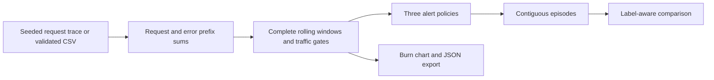

# SignalLab: research, plan, and design

Research date: November 14, 2026. Focus: software engineering and analytics. Public engineering publications inform the project; they are not evidence of an open internal project, a recruiter's scoring rubric, or a mandatory language.

## The decision

Build an SLO alert policy evaluator for an engineer deciding whether a service's errors should trigger an operational response. A generic uptime dashboard shows health; this project asks a falsifiable question: **how do alert noise, firing time, and detection delay change when the policy changes while traffic stays fixed?**

## Public sources and how they affected the build

| Primary source | Relevant guidance, paraphrased | Implemented consequence |
|---|---|---|
| [SRE Workbook: Alerting on SLOs](https://sre.google/workbook/alerting-on-slos/) — multiwindow, multi-burn-rate alerts; low-traffic services | Use error-budget burn and evaluate alert precision, recall, detection time, and reset behavior. The illustrative 30-day page rules pair 1h/5m at 14.4 and 6h/30m at 6. Low traffic needs care. | Request-weighted windows; OR of paired fast/slow rules; request gate; alert episodes; explicit label-based metrics. |
| [SRE Book: Handling Overload](https://sre.google/sre-book/handling-overload/) | Reliability behavior depends on demand, capacity, and failure handling. Operational controls have costs and limits. | Evaluate sustained behavior against brief disturbances. Do not infer real capacity or claim overload prevention from this replay. |

Both were fetched with HTTP 200. [research-sources.json](../artifacts/research-sources.json) records a fresh source retrieval, content hashes, and resolved URLs. The source pages can evolve; the implemented model is versioned independently.

The exact incident shapes, seeds, gate of 100 requests, local stack, and three-seed study are project choices. The thresholds come from the cited illustrative policy, not from tuning against the generated incidents. A 12-hour replay uses those rules but cannot establish a monthly budget balance.

## Completed plan

1. Research alert semantics and formulate comparison criteria → this document and source records.
2. Implement the replay model before the UI → `core.py`, independent rolling-window oracle in `tests/test_core.py`.
3. Implement a strict import boundary and actual HTTP API → `httpkit.py`, `server.py`, HTTP integration tests.
4. Build controls, charts, comparisons, import/export, and limitations into a local app → `web/`.
5. Run seeded evidence and browser workflows → `evidence.py`, `verify.py`, `browser_check.py`, and `artifacts/`.

## Data flow

The server binds to `127.0.0.1`; no external calls occur during replay. The browser renders actual API output. Imported service names and errors are escaped or assigned through `textContent`.

## Model contract

For a window, `error_ratio = sum(bad) / sum(total)` and `burn = error_ratio / (1 - SLO)`. Averaging minute percentages would overweight low-volume minutes, so the implementation uses prefix sums of counts. A window is unavailable until all its minute buckets exist and it has positive traffic meeting the configured minimum. Unavailable is distinct from healthy.

- Threshold policy: one-minute burn > 1.
- Short policy: five-minute burn > 14.4.
- Multiwindow policy: `(1h > 14.4 AND 5m > 14.4) OR (6h > 6 AND 30m > 6)`.

Comparisons use a small floating-point tolerance at thresholds. Adjacent firings merge into an episode per service; the end minute is exclusive. There is no separate cooldown, notification routing, or dedup service. Firing minutes sum across services and may exceed elapsed replay minutes.

An episode is labeled true if it overlaps any same-service actionable incident. Precision uses episodes as its denominator; recall uses labeled incidents. Delay is measured from incident start to the first overlapping firing, clipped to zero for an alert already active at incident start. These definitions do not measure operator effort or business damage. The synthetic brief edge disturbance is deliberately excluded from actionable labels; that classification is a modeling assumption. CSV imports have no labels and return null for these scores.

`replay_budget_use = bad / ((1 - SLO) * observed requests)`. It measures this replay's weighted error ratio relative to the allowed ratio. It is not a remaining 30-day budget. The run SHA-256 covers model version, normalized configuration, and trace contents; browser and CLI defaults are checked to agree.

CSV accepts exactly `minute,service,total,bad`, contiguous minutes beginning at zero per service, valid integer counts, at most 10,000 rows / 12 services / 800 KB. Missing buckets are rejected rather than filled as successes. No online requests, latency percentiles, or event-time interpolation are inferred.

## API and verification

| Route | Purpose |
|---|---|
| `GET /api/health` | Version and health |
| `GET /api/sample` | Downloadable demo CSV in JSON |
| `POST /api/analyze` | Validated SLO/seed/gate and optional CSV → computed report |

Core tests compare prefix-sum results to an independent brute-force calculation, verify weighting, unknown history, episode boundaries, scores, determinism, and import contracts. HTTP tests send real loopback requests, including malformed/non-finite JSON, foreign-origin writes, traversal attempts, and extra CSV columns. Browser tests verify controls, SVG rendering, imports, downloads, default hashes, and responsive layouts.

The HTTP boundary is intentionally small standard-library code: fixed static routes, bounded JSON bodies, strict object JSON, same-origin write checks, and a restrictive script CSP. This is a local demonstration server, not an internet-facing deployment.

## Choices and next useful extension

Python keeps analysis and backend logic together, while vanilla JavaScript avoids a build dependency for reviewers. SQLite, cloud services, and a large frontend framework would not improve this particular stateless replay question. The next evidence improvement would be a real anonymized request trace with independently labeled incidents and an evaluation period held out from policy selection. That is more useful than adding a company logo or inventing a language preference.
